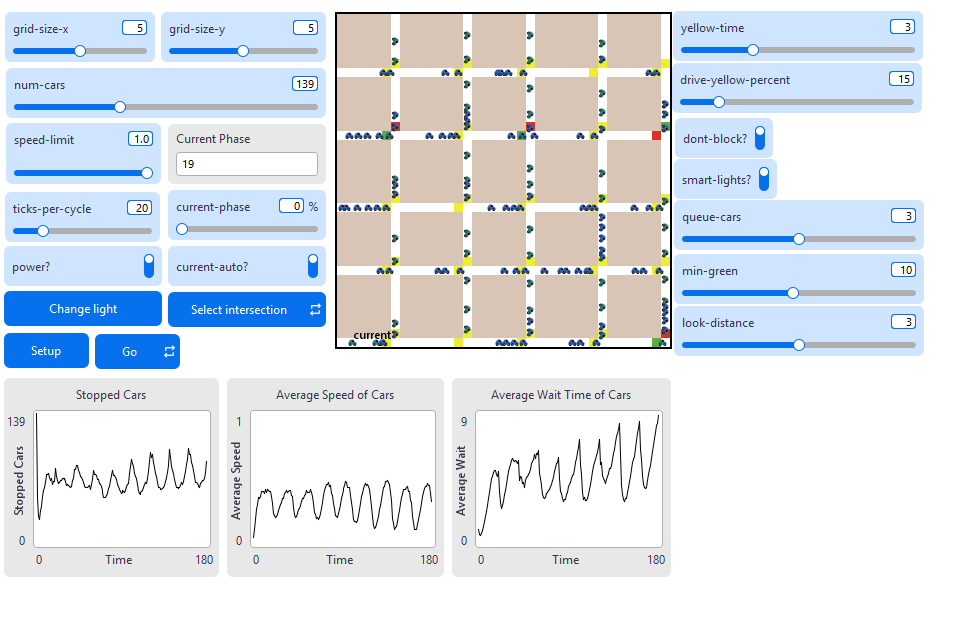
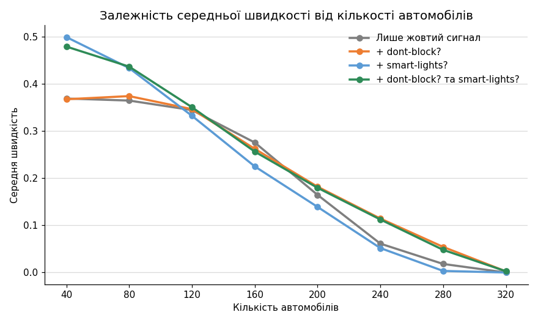
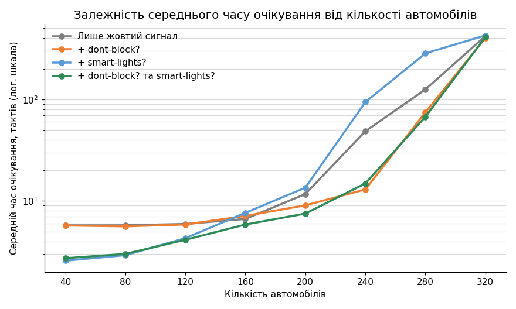

## Комп'ютерні системи імітаційного моделювання
## СПм-25-1, Батурін Олексій Олександарович
### Лабораторна робота №2. Редагування імітаційних моделей у середовищі NetLogo

 

### Варіант 1, модель у середовищі NetLogo:
[Traffic Grid](http://www.netlogoweb.org/launch#http://www.netlogoweb.org/assets/modelslib/Sample%20Models/Social%20Science/Traffic%20Grid.nlogo)

 

### Внесені зміни у вихідну логіку моделі, за варіантом:

**Додано жовтий сигнал світлофорів.**
В оригінальній моделі світлофор миттєво перемикається з червоного на зелений і навпаки. Світлофор у моделі не є окремим агентом: це колір двох клітинок перед перехрестям (`patch-at -1 0` для машин, що рухаються праворуч, та `patch-at 0 1` для машин, що рухаються донизу).

Для регулювання тривалості жовтого сигналу на інтерфейс додано новий керуючий параметр (слайдер) **yellow-time** (від 0 до 10 тактів). При значенні 0 жовтий сигнал вимкнено і модель поводиться як оригінальна.

До процедури `set-signals` додано другий блок: за `yellow-time` тактів до планового перемикання обидві клітинки світлофора перефарбовуються у жовтий колір. Момент перемикання перехрестя обчислюється так само, як в оригінальному коді (`floor ((my-phase * ticks-per-cycle) / 100)`), від нього віднімається `yellow-time`, а операція `mod` потрібна, щоб при переході через 0 значення фази не ставало від'ємним. Коли настає саме перемикання, процедура `set-signal-colors` перефарбовує клітинки назад у червоний та зелений, тому окремо скидати жовтий не потрібно.
<pre>
to set-signals
  ask intersections with [auto? and phase = floor ((my-phase * ticks-per-cycle) / 100)]
  [
    set green-light-up? (not green-light-up?)
    set-signal-colors
  ]

  ;; за yellow-time тактів до перемикання вмикається жовтий сигнал
  if power? and yellow-time > 0
  [
    ask intersections with [auto? and phase = (floor ((my-phase * ticks-per-cycle) / 100) - yellow-time) mod ticks-per-cycle]
    [
      ask patch-at -1 0 [set pcolor yellow]
      ask patch-at 0 1 [set pcolor yellow]
    ]
  ]
end
</pre>
Значення `yellow-time` має бути меншим за `ticks-per-cycle`, інакше момент увімкнення жовтого сигналу збігається з перемиканням або виходить за межі циклу. Пізніше, при додаванні розумних світлофорів, цей механізм було перероблено (див. зміни на власний розсуд).

**Додано ймовірність початку руху на жовтий сигнал.**
Кожен водій при створенні отримує характер: звичайний або "ризиковий". Для цього до змінних агентів-машин додано логічну змінну **risky?**:
<pre>
turtles-own
[
  speed     ;; the speed of the turtle
  up-car?   ;; true if the turtle moves downwards and false if it moves to the right
  wait-time ;; the amount of time since the last time a turtle has moved
  risky?    ;; true, якщо водій їде на жовтий сигнал
]
</pre>
Частка ризикових водіїв задається новим керуючим параметром (слайдером) **drive-yellow-percent** (від 0 до 100%). Значення `risky?` встановлюється один раз при створенні машини у процедурі `setup`: генерується випадкове число від 0 до 100, і якщо воно менше за значення слайдера, водій вважається ризиковим.
<pre>
  create-turtles num-cars
  [
    setup-cars
    ;; з ймовірністю drive-yellow-percent водій стає ризиковим
    set risky? (random-float 100 < drive-yellow-percent)
    set-car-color
    record-data
  ]
</pre>
Рішення приймається один раз для кожного водія, а не випадково на кожному такті, оскільки воно відображає "характер" водія. Якщо кидати жереб на кожному такті, то за кілька тактів жовтого сигналу майже кожен водій хоча б раз вирішив би поїхати.

У процедурі `set-car-speed` змінено умову зупинки: машина зупиняється, якщо під нею червоний сигнал, або якщо жовтий сигнал і водій не є ризиковим.
<pre>
  ifelse pcolor = red or (not risky? and pcolor = yellow) or (dont-block? and exit-blocked?)
  [ set speed 0 ]
</pre>
(Остання частина умови відноситься до змін на власний розсуд.) Жовтий сигнал горить для обох напрямків, тому ризикові водії і "проскакують" на жовтий після зеленого, і починають рух на жовтий після червоного, тобто раніше за звичайних водіїв. Зіткнень при цьому не відбувається: в оригінальній процедурі `set-speed` машина зупиняється, якщо на клітинці попереду знаходиться машина поперечного напрямку.

 

### Внесені зміни у вихідну логіку моделі, на власний розсуд:

**1. Заборона виїзду на заблоковане перехрестя.**
Під час виконання лабораторної роботи №1 було виявлено, що при великій кількості автомобілів мережа доріг повністю блокується: машини виїжджають на перехрестя, впираються в чергу за ним і перекривають рух у поперечному напрямку. У реальності правила дорожнього руху забороняють виїжджати на перехрестя, якщо за ним утворився затор.

Для реалізації цього правила на інтерфейс додано перемикач **dont-block?**, а також нову функцію `exit-blocked?`, яка перевіряє, чи знаходиться попереду машини перехрестя і чи є автомобіль на клітинці одразу за ним:
<pre>
;; перевірка, чи стоїть машина одразу за перехрестям, на яке машина збирається в'їхати
to-report exit-blocked?  ;; turtle procedure
  let next-cell ifelse-value up-car? [patch-at 0 -1] [patch-at 1 0]
  let cell-after-intersection ifelse-value up-car? [patch-at 0 -2 ] [patch-at 2 0]
  report [intersection?] of next-cell and any? (turtles-on cell-after-intersection) with [speed = 0]
end
</pre>
Для машини, що рухається донизу (`up-car?` = true), наступна клітинка знаходиться нижче (`0 -1`), а клітинка за перехрестям ще на одну нижче (`0 -2`). Для машини, що рухається праворуч, відповідно `1 0` та `2 0`. Враховуються лише машини, що стоять (`speed = 0`): якщо машина за перехрестям рухається, вона встигне звільнити місце. (У першій версії враховувалася будь-яка машина, через що автомобілі чекали без потреби і середня швидкість знижувалася.) Якщо правило увімкнено і виїзд з перехрестя зайнятий, машина чекає перед перехрестям навіть на зелений сигнал (умова `(dont-block? and exit-blocked?)` у процедурі `set-car-speed`, наведена вище).

**2. "Розумні" світлофори.**
В оригінальній моделі всі світлофори перемикаються строго за розкладом, навіть якщо з одного боку стоїть черга, а з іншого боку перехрестя порожнє. Додано режим, у якому світлофор перемикається достроково, якщо на червоному сигналі зібралася черга, а з боку зеленого сигналу машин немає. Дострокове перемикання також відбувається через жовтий сигнал.

На інтерфейс додано нові керуючі параметри:
- **smart-lights?**: вмикає режим розумних світлофорів;
- **look-distance**: на скільки клітинок перед перехрестям світлофор "бачить" машини (від 1 до 5);
- **queue-cars**: скільки машин у цій зоні має стояти на червоному, щоб перемкнути світлофор (від 1 до 5, має бути не більшим за look-distance);
- **min-green**: мінімальна кількість тактів між перемиканнями, щоб світлофор не "блимав" (від 1 до 20).

**Переробка механізму жовтого сигналу.** Жовтий сигнал у початковій реалізації прив'язаний до глобального розкладу `phase`: він вмикається лише перед плановим перемиканням і не може увімкнутися перед достроковим перемиканням розумного світлофора. Тому механізм жовтого сигналу перероблено: будь-яке перемикання (планове, дострокове чи ручне) тепер відбувається у два етапи, спочатку на `yellow-time` тактів вмикається жовтий сигнал, а після цього світлофор перемикається. Для цього до змінних перехресть (`patches-own`) додано лічильник жовтого сигналу та такт останнього перемикання:
<pre>
  last-switch     ;; такт, коли світлофор перемикався востаннє
  yellow-left     ;; скільки тактів жовтого залишилось до перемикання (0: немає)
</pre>
Процедура `start-yellow` вмикає жовтий сигнал і запускає відлік, а процедура `switch-light` виконує власне перемикання. Повторюваний код перемикання винесено в окрему процедуру, оскільки він використовується в кількох місцях (після жовтого сигналу, при вимкненому жовтому та при ручному перемиканні кнопкою *Change light*).
<pre>
;; почати перемикання: увімкнути жовтий (або перемкнути одразу, якщо жовтий вимкнено)
to start-yellow  ;; intersection (patch) procedure
  ifelse power? and yellow-time > 0
  [
    set yellow-left yellow-time
    ask patch-at -1 0 [set pcolor yellow]
    ask patch-at 0 1 [set pcolor yellow]
  ]
  [ switch-light ]
end

;; власне перемикання червоний/зелений із запам'ятовуванням такту перемикання
to switch-light  ;; intersection (patch) procedure
  set green-light-up? (not green-light-up?)
  set-signal-colors
  set last-switch ticks
end
</pre>
Процедуру ручного перемикання `change-current` також переведено на `switch-light`, щоб при ручному перемиканні оновлювався такт останнього перемикання:
<pre>
to change-current
  ask current-light [ switch-light ]
end
</pre>
При вимкнених розумних світлофорах перероблений механізм працює так само, як початкова реалізація: жовтий сигнал вмикається за `yellow-time` тактів до планового перемикання.

Для підрахунку машин перед перехрестям додано дві функції. `n-values` створює список із `look-distance` клітинок перед перехрестям, `patch-set` перетворює його на набір клітинок, а `turtles-on` знаходить машини на цих клітинках:
<pre>
;; машини, що під'їжджають зліва (рухаються праворуч), на look-distance клітинках перед перехрестям
to-report cars-left  ;; intersection (patch) procedure
  let zone patch-set n-values look-distance [ i -> patch-at (- (i + 1)) 0 ]
  report count (turtles-on zone) with [not up-car?]
end

;; машини, що під'їжджають згори (рухаються донизу), на look-distance клітинках перед перехрестям
to-report cars-up  ;; intersection (patch) procedure
  let zone patch-set n-values look-distance [ i -> patch-at 0 (i + 1) ]
  report count (turtles-on zone) with [up-car?]
end
</pre>
Функція `want-switch?` визначає, з якого боку зараз червоний сигнал (залежно від `green-light-up?`), і повертає true, якщо на червоному черга не менша за `queue-cars`, а з боку зеленого машин немає:
<pre>
;; чи варто перемкнути достроково: на червоному черга не менша за queue-cars,
;; а з боку зеленого машин немає
to-report want-switch?  ;; intersection (patch) procedure
  let red-cars ifelse-value green-light-up? [cars-left] [cars-up]
  let green-cars ifelse-value green-light-up? [cars-up] [cars-left]
  report red-cars >= queue-cars and green-cars = 0
end
</pre>
У процедуру `set-signals` додано третій крок: дострокове перемикання, якщо від попереднього перемикання минуло не менше `min-green` тактів:
<pre>
  ;; 3. дострокове перемикання розумного світлофора
  if smart-lights?
  [
      ask intersections with [auto? and yellow-left = 0 and ticks - last-switch >= min-green and want-switch?]
      [ start-yellow ]
  ]
</pre>
**Збереження синхронності світлофорів.** В оригінальній моделі всі світлофори перемикаються одночасно (у всіх перехресть однакова фаза), що створює "зелену хвилю": якщо горизонтальному напрямку горить зелений, то на всіх перехрестях одразу. Планове перемикання є інверсією сигналу, тому після дострокового перемикання світлофор опинився б у протифазі з усіма іншими. Щоб світлофор після дострокового перемикання повертався до загального ритму, кожне перехрестя запам'ятовує, який сигнал має горіти за розкладом:
<pre>
  planned-up?     ;; який сигнал має бути за загальним розкладом (як green-light-up?)
</pre>
Початкове значення задається у `setup-intersections` так само, як для `green-light-up?`:
<pre>
    set green-light-up? true
    set planned-up? true
</pre>
У момент планового перемикання розклад змінює `planned-up?` у всіх перехресть, а світлофор перемикається лише тоді, коли його поточний сигнал відрізняється від розкладу. Якщо світлофор уже перемкнувся достроково і його сигнал збігається з розкладом, повторне перемикання не потрібне, і світлофор знову працює синхронно з іншими. Без розумних світлофорів сигнал у момент зміни розкладу завжди відрізняється від нього, тому модель працює так само, як раніше.

Повний код процедури `set-signals` після всіх змін:
<pre>
;; керування світлофорами: планове та дострокове перемикання через жовтий сигнал
to set-signals
  ;; 1. відлік жовтого: коли закінчився, перемикаємо світлофор
  ask intersections with [yellow-left > 0]
  [
    set yellow-left yellow-left - 1
    if yellow-left = 0 [switch-light]
  ]

  ;; 2. планове перемикання за загальним розкладом phase (однаковим для всіх перехресть)
  ;;    розклад змінює planned-up?, а світлофор перемикається лише якщо його сигнал
  ;;    відрізняється від розкладу (після дострокового перемикання він може вже збігатися)
  ask intersections with [auto? and
      phase = floor ((my-phase * ticks-per-cycle) / 100 - yellow-time) mod ticks-per-cycle]
  [
    set planned-up? (not planned-up?)
    if yellow-left = 0 and green-light-up? != planned-up? [ start-yellow ]
  ]

  ;; 3. дострокове перемикання розумного світлофора
  if smart-lights?
  [
      ask intersections with [auto? and yellow-left = 0 and ticks - last-switch >= min-green and want-switch?]
      [ start-yellow ]
  ]
end
</pre>
Крок 1 (відлік жовтого сигналу) та крок 2 (планове перемикання через `start-yellow`) замінили початковий блок жовтого сигналу, а крок 3 додає дострокове перемикання. `planned-up?` змінюється у всіх перехресть, навіть у тих, де зараз горить жовтий сигнал дострокового перемикання, інакше таке перехрестя пропустило б зміну розкладу і випало з загального ритму.

 

Фінальний код моделі та її інтерфейс доступні за [посиланням](Traffic%20Grid_lb2_final.nlogox). Версія моделі лише зі змінами за варіантом (початкова реалізація жовтого сигналу): [посилання](Traffic%20Grid_lb2basetaskdone.nlogox).

 

## Обчислювальні експерименти
### 1. Вплив внесених змін на рух автомобілів при різному завантаженні доріг
Досліджується, як нові правила (заборона виїзду на заблоковане перехрестя та розумні світлофори) впливають на середню швидкість автомобілів і середній час очікування при різній кількості автомобілів (**num-cars** від 40 до 320 з кроком 40). Порівнюються чотири режими: лише жовтий сигнал (обидва нові правила вимкнено), з правилом **dont-block?**, з **smart-lights?** та з обома правилами одночасно.

Для кожної комбінації параметрів виконано 5 запусків тривалістю 500 тактів (усього 160 запусків у BehaviorSpace). Показники усереднені за останні 100 тактів кожного запуску (такти з 401 по 500), а потім за запусками. Усереднення за часом потрібне тому, що при замірі в один момент (наприклад, лише на 500-му такті) результат сильно залежить від того, чи потрапив цей момент на жовтий сигнал: при плановому перемиканні всі світлофори вмикають жовтий одночасно, і в цей момент більшість машин стоїть.

Інші керуючі параметри:
- **grid-size-x**, **grid-size-y**: 5
- **speed-limit**: 1
- **ticks-per-cycle**: 20
- **current-phase**: 0
- **power?**: on
- **yellow-time**: 3
- **drive-yellow-percent**: 15
- **queue-cars**: 2
- **look-distance**: 3
- **min-green**: 5

Середня швидкість:
<table>
<thead>
<tr><th>Кількість автомобілів</th><th>Лише жовтий сигнал</th><th>+ dont-block?</th><th>+ smart-lights?</th><th>+ dont-block? та smart-lights?</th></tr>
</thead>
<tbody>
<tr><td>40</td><td>0,369</td><td>0,368</td><td>0,500</td><td>0,480</td></tr>
<tr><td>80</td><td>0,365</td><td>0,374</td><td>0,434</td><td>0,437</td></tr>
<tr><td>120</td><td>0,345</td><td>0,347</td><td>0,333</td><td>0,351</td></tr>
<tr><td>160</td><td>0,276</td><td>0,262</td><td>0,225</td><td>0,257</td></tr>
<tr><td>200</td><td>0,165</td><td>0,182</td><td>0,139</td><td>0,180</td></tr>
<tr><td>240</td><td>0,061</td><td>0,114</td><td>0,052</td><td>0,113</td></tr>
<tr><td>280</td><td>0,018</td><td>0,054</td><td>0,003</td><td>0,048</td></tr>
<tr><td>320</td><td>0,000</td><td>0,002</td><td>0,000</td><td>0,003</td></tr>
</tbody>
</table>

Середній час очікування, тактів:
<table>
<thead>
<tr><th>Кількість автомобілів</th><th>Лише жовтий сигнал</th><th>+ dont-block?</th><th>+ smart-lights?</th><th>+ dont-block? та smart-lights?</th></tr>
</thead>
<tbody>
<tr><td>40</td><td>5,8</td><td>5,7</td><td>2,6</td><td>2,7</td></tr>
<tr><td>80</td><td>5,8</td><td>5,6</td><td>2,9</td><td>3,0</td></tr>
<tr><td>120</td><td>5,9</td><td>5,9</td><td>4,3</td><td>4,2</td></tr>
<tr><td>160</td><td>6,7</td><td>7,1</td><td>7,7</td><td>5,9</td></tr>
<tr><td>200</td><td>11,7</td><td>9,1</td><td>13,5</td><td>7,5</td></tr>
<tr><td>240</td><td>48,6</td><td>13,0</td><td>94,1</td><td>14,9</td></tr>
<tr><td>280</td><td>125,1</td><td>74,4</td><td>283,7</td><td>67,3</td></tr>
<tr><td>320</td><td>419,6</td><td>401,9</td><td>425,9</td><td>410,0</td></tr>
</tbody>
</table>

**Висновки.**

За результатами експерименту можна побачити, що розумні світлофори добре працюють, коли машин на дорогах мало. При 40 автомобілях середня швидкість зросла з 0,37 до 0,50, а час очікування зменшився більш ніж удвічі (з 5,8 до 2,6 такту). Це логічно, бо світлофор більше не тримає машини на червоному, коли з іншого боку перехрестя нікого немає. Але якщо машин стає більше (від 160), то самі по собі розумні світлофори вже погіршують рух, а при 280 автомобілях швидкість падає до 0,003 проти 0,018 у базовому режимі.

Заборона виїзду на заблоковане перехрестя, навпаки, майже нічого не змінює при малому завантаженні, зате дуже допомагає, коли машин багато. Наприклад, при 240 автомобілях швидкість вийшла майже вдвічі більшою (0,114 проти 0,061), а час очікування зменшився приблизно в 4 рази (13,0 проти 48,6 такту).

Найкращий результат вийшов, коли увімкнені обидва правила одночасно. При малому завантаженні працюють розумні світлофори, а при великому заборона виїзду не дає мережі заблокуватися. Час очікування в цьому режимі менший, ніж у базовому, при будь-якій кількості машин, а швидкість більша майже скрізь, крім 160 автомобілів, де вона трохи нижча (0,257 проти 0,276).

При 320 автомобілях не допомагає жодне з правил, бо машин стає забагато для такої кількості доріг і мережа блокується в усіх режимах.

### 2. Аналіз і виправлення першої версії розумних світлофорів
У першій версії розумних світлофорів планове перемикання відраховувалося від останнього перемикання кожного світлофора (`ticks - last-switch >= ticks-per-cycle - yellow-time`), а функція `exit-blocked?` враховувала будь-яку машину за перехрестям. За тих самих умов експерименту 1 розумні світлофори при 160 автомобілях знижували середню швидкість з 0,26 до 0,05, тобто мережа повністю блокувалася.

Для пошуку причини було проведено додаткові обчислювальні експерименти (120 та 200 автомобілів, min-green 5, 10, 15 та 20, yellow-time 0 та 3, по 5 запусків), у яких, окрім швидкості, вимірювалися частка часу з жовтим сигналом (`count intersections with [yellow-left > 0] / count intersections`) та кількість машин, що стоять на перехрестях (`count turtles with [intersection? and speed = 0]`). Результати при 200 автомобілях:

<table>
<thead>
<tr><th>Режим</th><th>Середня швидкість</th><th>Частка часу з жовтим</th><th>Машин застрягло на перехрестях</th></tr>
</thead>
<tbody>
<tr><td>Звичайні світлофори</td><td>0,156</td><td>15%</td><td>5,7</td></tr>
<tr><td>Розумні, min-green = 5</td><td>0,008</td><td>16%</td><td>19,4</td></tr>
<tr><td>Розумні, min-green = 5, без жовтого</td><td>0,040</td><td>0%</td><td>17,1</td></tr>
<tr><td>Звичайні, з випадковою фазою кожного перехрестя</td><td>0,009</td><td>не вимірювалась</td><td>19,3</td></tr>
</tbody>
</table>

Гіпотези про надто часті перемикання та втрату часу на жовтий сигнал не підтвердилися: розумні світлофори перемикаються лише на кілька відсотків частіше, а без жовтого сигналу мережа також блокується. Натомість звичайні світлофори з випадковими фазами (задавались командою `ask intersections [ set my-phase random 100 ]` після `setup`) блокують мережу так само, як розумні. Отже, причина в розсинхронізації світлофорів: після дострокового перемикання світлофор назавжди виходив із загального ритму, "зелена хвиля" руйнувалася, черги від червоного світла доростали до попередніх перехресть, машини застрягали на перехрестях і перекривали поперечний напрямок.

На основі цього аналізу внесено два виправлення, описані вище: планове перемикання за загальним розкладом із запам'ятовуванням `planned-up?` та врахування в `exit-blocked?` лише машин, що стоять. Після виправлення розумні світлофори при 160 автомобілях дають швидкість 0,225 замість 0,046, а з обома правилами 0,257 замість 0,160.
